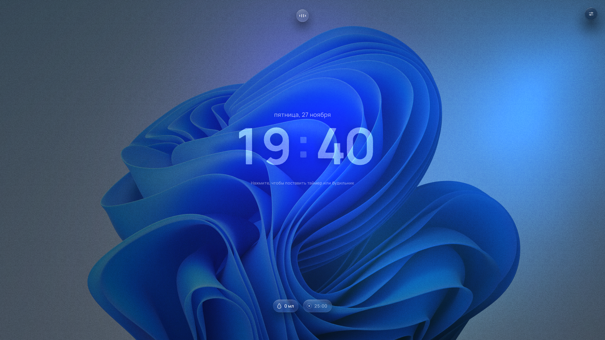

# Glaxe

Живые обои для Windows 11. Поставь свою картинку, GIF или видео за живым стеклом и добавь на рабочий стол часы, музыку и задачи. Один файл `.exe`, без установки и прав администратора.

## [Скачать Glaxe.exe](https://github.com/glaxe23/glaxe/releases/latest/download/Glaxe.exe)

## Возможности

- **Живой фон.** «Свечение», «Поток», «Рифлёное стекло» и «Радужное стекло». Огни реагируют на музыку, курсор оставляет след, а стекло можно «протереть» мышью.
- **Свои обои.** Используй картинку, GIF или видео. Кнопка «Взять обои Windows» подберёт цвета интерфейса под фон.
- **Виджеты.** Перетаскиваемые часы с таймером, погода, плеер с обложкой и текстом песни в такт, свои задачи или задачи из Obsidian.
- **На каждый день.** Помодоро, учёт воды, будильники, календарь `.ics`, расписание пар и звуки природы с каплями на стекле.
- **Оформление.** Готовые стили, обмен ими через файлы `.glaxe`, тема по времени суток, свой цвет рамки выделения и режим для всех мониторов.
- **Режимы.** Повседневный, рабочий и игровой. Игровой может включаться автоматически при запуске игры.
- **Нагрузка.** Glaxe приостанавливает фон, когда окна закрывают рабочий стол. В тесте на RX 580 при 1080p открытый рабочий стол потреблял около 6% ресурсов видеокарты, а Glaxe занимал около 250–300 МБ оперативной памяти.
- **Дополнения по желанию.** Стеклянная панель задач и Проводник через Windhawk, раскладка окон плиткой через GlazeWM.

[Радужное стекло](docs/2.png) · [Настройки оформления](docs/3.png)

## Как запустить

1. Скачай `Glaxe.exe` по ссылке выше.
2. Запусти файл двойным щелчком.
3. Если SmartScreen покажет синее окно «Windows защитила ваш компьютер», нажми **Подробнее → Выполнить в любом случае**. У сборки нет цифровой подписи.

## Системные требования

- Windows 11, 64-разрядная.
- Видеокарта с поддержкой DirectX 11.
- Около 200 МБ для скачанного файла и около 425 МБ для компонентов, которые Glaxe распакует при первом запуске.

## Известные ограничения

- Это бета-версия. Windows 10 и работа на втором мониторе пока не проверены на реальных ПК.
- Панель настроек может не открыться, если имя пользователя Windows очень длинное.
- Текст песен берётся из LRCLIB и доступен для части треков.

## Нашёл ошибку?

Нажми значок Glaxe рядом с часами → **Сообщить об ошибке…**. Glaxe создаст ZIP-архив с отчётом. Отправь его автору в Telegram и коротко опиши, что случилось.

## Как удалить

1. Нажми значок Glaxe рядом с часами → **Убрать Glaxe из системы…** и подтверди действие.
2. Удали файл `Glaxe.exe` и папку `%LOCALAPPDATA%\Glaxe`.
